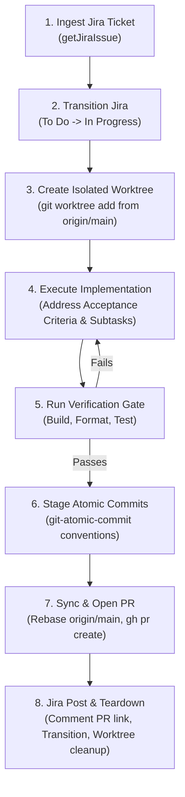

# Jira Story Implementer

The **jira-story-implementer** skill guides agents through the end-to-end implementation of Jira user stories. It guarantees zero working-tree contamination by utilizing isolated git worktrees, enforces code standards through automated verification gates, preserves git history through atomic Conventional Commits, seamlessly opens standardized GitHub Pull Requests, and synchronizes issue status with Jira in real time.

---

## 🛡️ Core Guarantees

1. **Jira MCP Source of Truth**: Reads story description, acceptance criteria, parent epic, and subtasks directly from Jira (`getJiraIssue`). Never hallucinates tickets or requirements.
2. **Automated Status Synchronization**:
   - Automatically transitions issue from `To Do` $\rightarrow$ `In Progress` upon worktree setup.
   - Posts PR links and updates subtasks upon PR opening.
3. **Strict Worktree Isolation**:
   - Never implements directly in a dirty or existing development workspace branch.
   - Always fetches `origin/main` and spins up a dedicated git worktree (`.worktrees/<branch-name>` or `../<repo>-wt-<key>`).
4. **Local Verification Gate**:
   - Every change must satisfy TypeScript build/typechecking, code formatting (`prettier`), and test suites before any commit is finalized.
5. **Atomic Commits (`git-atomic-commit`)**:
   - Changes are split into bisectable, single-logical-unit Conventional Commits labeled with the Jira ticket key:
     `type(scope): [<KEY>] <imperative description>`
6. **PR Automation (`pr-creator`)**:
   - Synchronizes against latest `origin/main`, validates branch naming, and generates an audit-ready PR description linked to Jira and parent epics.

---

## 🔄 End-to-End Execution Protocol



---

## Phase 1: Ingest Jira Ticket & Transition to In Progress

### 1.1 Retrieve Ticket Context
Use `atlassian-mcp-server` to fetch the ticket:
1. Ensure the site `cloudId` is known (call `getAccessibleAtlassianResources` once if not cached).
2. Fetch the target issue:
   ```json
   {
     "cloudId": "<cloudId>",
     "issueIdOrKey": "<JIRA-KEY>",
     "view": "full"
   }
   ```
3. Extract and display:
   - **Key & Summary**: e.g., `GL-8: 0.2 BE [Grizz] Reject unauthenticated chat and stats requests`
   - **Parent Epic**: Key, title, and goals.
   - **Acceptance Criteria**: All bulleted or numbered requirements.
   - **Subtasks**: Child task keys and summaries.

### 1.2 Transition to In Progress
1. Query valid transitions for the issue:
   Call `executeRead` with `name: "listJiraIssueTransitions"`:
   ```json
   {
     "cloudId": "<cloudId>",
     "name": "listJiraIssueTransitions",
     "inputs": { "issueIdOrKey": "<JIRA-KEY>" }
   }
   ```
2. Locate the transition leading to status category `indeterminate` or name `In Progress` (e.g., transition id `21`).
3. Call `transitionJiraIssue`:
   ```json
   {
     "cloudId": "<cloudId>",
     "issueIdOrKey": "<JIRA-KEY>",
     "transitionId": "<transitionId>"
   }
   ```
4. Verify the response confirms the issue has moved to `In Progress`.

---

## Phase 2: Isolated Worktree Setup

### 2.1 Branch Naming Specification
Branch names must strictly conform to the repository standard:
```text
<type>/<JIRA-KEY>-<kebab-case-slug>
```
- `<type>`: `feat`, `fix`, `refactor`, `test`, `chore`, `docs`
- `<JIRA-KEY>`: Uppercase Jira issue key (e.g., `GL-8`)
- `<kebab-case-slug>`: Short description (max 40 chars, lowercase, hyphens only)

*Example*: `fix/GL-8-reject-unauthenticated-requests`

### 2.2 Worktree Creation
Worktrees ensure the active workspace branch remains untouched:
1. Fetch latest remote main:
   ```bash
   git fetch origin main
   ```
2. Determine the worktree path:
   - Preferred: `.worktrees/<branch-name>` (ensure `.worktrees` is in `.gitignore`)
   - Alternative: `../<repo-name>-wt-<JIRA-KEY>`
3. Create the worktree:
   ```bash
   git worktree add -b <branch-name> <worktree-path> origin/main
   ```
4. Switch working context or execute commands within the new worktree directory.
5. If the project uses node modules or virtual environments not checked in, install or link dependencies if needed (e.g., `npm ci`).

---

## Phase 3: Implementation & Quality Verification Gate

### 3.1 Subtask & Criteria Mapping
Create an execution checklist in your plan mapping each Jira Acceptance Criterion and subtask to specific file changes.

### 3.2 Code Standards Checklist
Before creating any commit, verify all applicable quality gates inside the worktree:

| Gate | Check Command | Requirement |
| :--- | :--- | :--- |
| **Type Safety** | `npm run build:ts` or `npx tsc --noEmit` | 0 errors |
| **Formatting** | `npm run format:check` or `npx prettier --check .` | Clean format |
| **Linting** | `npm run lint` or `npx eslint .` | 0 errors |
| **Unit Tests** | `npm test` | All tests pass, zero regressions |

If any gate fails, fix the errors before moving to the commit phase.

---

## Phase 4: Atomic Commit Sequencing

Follow the principles of the **`git-atomic-commit`** skill:
- **One logical change per commit**: Do not mix formatting with logic, or refactors with new features.
- **Every commit must compile**: Never commit a partial state that breaks the build or tests.
- **Linguistic test**: If the commit subject requires an "and", split it into multiple commits.

### Commit Format
```text
<type>(<scope>): [<JIRA-KEY>] <imperative subject>

[optional body explaining motivation and context]
```

*Examples*:
- `chore(test): [GL-8] add backend test tsconfig and fix test script`
- `feat(auth): [GL-8] add constant-time isAuthorized helper`
- `feat(stream): [GL-8] return 401 via HttpResponseStream on invalid key`
- `test(auth): [GL-8] add unit tests for authorization helper`
- `docs(env): [GL-8] document INTERNAL_API_KEY in .env.example`

Stage files explicitly using pathnames (avoid blanket `git add -A`):
```bash
git add backend/src/utils/auth.ts
git commit -m "feat(auth): [GL-8] add constant-time isAuthorized helper"
```

---

## Phase 5: Rebase & Pull Request Creation

### 5.1 Rebase Synchronization
Ensure the branch has zero divergence from latest `main`:
```bash
git fetch origin main
git rebase origin/main
```
If rebase produces conflicts, resolve them and verify the test gate again.

### 5.2 Push Branch
```bash
git push -u origin <branch-name>
```

### 5.3 Open Pull Request
Use the GitHub CLI (`gh pr create`) with the standardized PR template:

```bash
gh pr create \
  --base main \
  --head <branch-name> \
  --title "<type>(<scope>): [<JIRA-KEY>] <imperative description>" \
  --body-file "<path-to-rendered-pr-body>"
```

The PR body must include:
- Jira ticket URL & Parent Epic URL
- Executive summary
- Acceptance criteria checklist (marked complete `[x]`)
- Verification test evidence output
- Architecture & security compliance notes

---

## Phase 6: Jira Update & Worktree Teardown

### 6.1 Comment on Jira Issue
Add a comment containing the PR link and execution summary using `addOrEditJiraIssueComment`:
```json
{
  "cloudId": "<cloudId>",
  "issueIdOrKey": "<JIRA-KEY>",
  "body": "Implemented in Pull Request: <PR_URL>\n\n- All acceptance criteria satisfied.\n- Verification tests and typechecks passing."
}
```

### 6.2 Workflow Transition
1. Query transitions with `listJiraIssueTransitions`.
2. If the project uses `In Review`, transition to `In Review`.
3. If the workflow allows moving to `Done` once PR is submitted, transition to `Done` (or as agreed by project conventions).
4. Update child subtasks if applicable.

### 6.3 Worktree Cleanup
Once the branch is pushed and PR is confirmed:
```bash
# Return to root workspace
git worktree remove <worktree-path>
```
If the user prefers to keep the worktree until the PR is merged, notify them of the worktree location.

---

## 🛠️ Quick Reference

| Action | Command / Tool Call |
| :--- | :--- |
| **Fetch Story** | `getJiraIssue({ cloudId, issueIdOrKey: "GL-8", view: "full" })` |
| **List Transitions** | `executeRead({ name: "listJiraIssueTransitions", cloudId, inputs: { issueIdOrKey: "GL-8" } })` |
| **Transition Issue** | `transitionJiraIssue({ cloudId, issueIdOrKey: "GL-8", transitionId: "21" })` |
| **Add Worktree** | `git worktree add -b <branch> <path> origin/main` |
| **Verify Standards** | `npm run build && npm run format:check && npm test` |
| **Atomic Commit** | `git commit -m "feat(<scope>): [<KEY>] <subject>"` |
| **Create PR** | `gh pr create --base main --title "..." --body "..."` |
| **Prune Worktree** | `git worktree remove <path>` |
