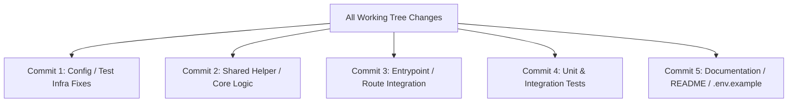

# Jira Story Implementer: Workflows & Technical Reference

This reference covers common scenarios, Git worktree operations, Atlassian MCP transitions, and troubleshooting when implementing Jira user stories.

---

## 1. Git Worktree Lifecycle & Best Practices

Git worktrees allow having multiple branches checked out simultaneously in different directories from the same repository clone.

### Creating a Worktree
```bash
# 1. Ensure you have the latest remote tracking branches
git fetch origin main

# 2. Create a new branch off origin/main in a dedicated directory
git worktree add -b <branch-name> .worktrees/<branch-name> origin/main

# Or as a sibling folder:
git worktree add -b <branch-name> ../genai-lab-wt-<JIRA-KEY> origin/main
```

### Navigating & Operating Inside the Worktree
When working in the worktree:
- Dependencies: If `node_modules` is not shared or ignored, run `npm ci` inside the worktree root or subfolder (e.g. `cd backend && npm ci`).
- Git commands inside the worktree automatically target that branch and its working files.

### Inspecting Worktrees
```bash
git worktree list
```

### Removing & Cleaning Up
```bash
# Remove worktree after PR creation or merge
git worktree remove .worktrees/<branch-name>

# If there were untracked build artifacts, you can force remove:
git worktree remove --force .worktrees/<branch-name>

# Prune stale metadata
git worktree prune
```

---

## 2. Atlassian Jira Transitions Reference

Different Jira workflows map statuses differently. Always probe the valid transitions first before attempting a transition.

### Step 1: List Transitions
Tool: `executeRead`
- `name`: `"listJiraIssueTransitions"`
- `inputs`: `{ "issueIdOrKey": "GL-8" }`

Example response:
```json
{
  "transitions": [
    { "id": "11", "name": "To Do", "to": { "name": "To Do", "statusCategory": { "key": "new" } } },
    { "id": "21", "name": "In Progress", "to": { "name": "In Progress", "statusCategory": { "key": "indeterminate" } } },
    { "id": "31", "name": "Done", "to": { "name": "Done", "statusCategory": { "key": "done" } } }
  ]
}
```

### Step 2: Transition Issue
Tool: `transitionJiraIssue`
- `issueIdOrKey`: `"GL-8"`
- `transitionId`: `"21"` (matches "In Progress")

### Common Status Category Mappings:
- `new`: To Do / Open / Backlog
- `indeterminate`: In Progress / In Development / In Review
- `done`: Done / Closed / Resolved

---

## 3. Atomic Commit Grouping Strategy

When multiple files are modified during story implementation, sort them into atomic units:



### Linguistic Rule:
Draft the message subject. If you need the word "and", split it into two commits:
- ❌ `feat(auth): add isAuthorized helper and update lambda handler`
- ✅ Commit 1: `feat(auth): [GL-8] add constant-time isAuthorized helper`
- ✅ Commit 2: `feat(stream): [GL-8] enforce isAuthorized check in lambda handler`

---

## 4. GitHub PR CLI Template Command

```bash
gh pr create \
  --base main \
  --head "<branch-name>" \
  --title "<type>(<scope>): [<JIRA-KEY>] <imperative description>" \
  --body "## 📌 Jira Ticket
- **Issue**: [GL-8](https://the-three-devsketeers.atlassian.net/browse/GL-8)

## 🎯 Executive Summary
...

## 📋 Acceptance Criteria Checklist
- [x] A request to the stream Function URL without a valid key gets HTTP 401
...
"
```
