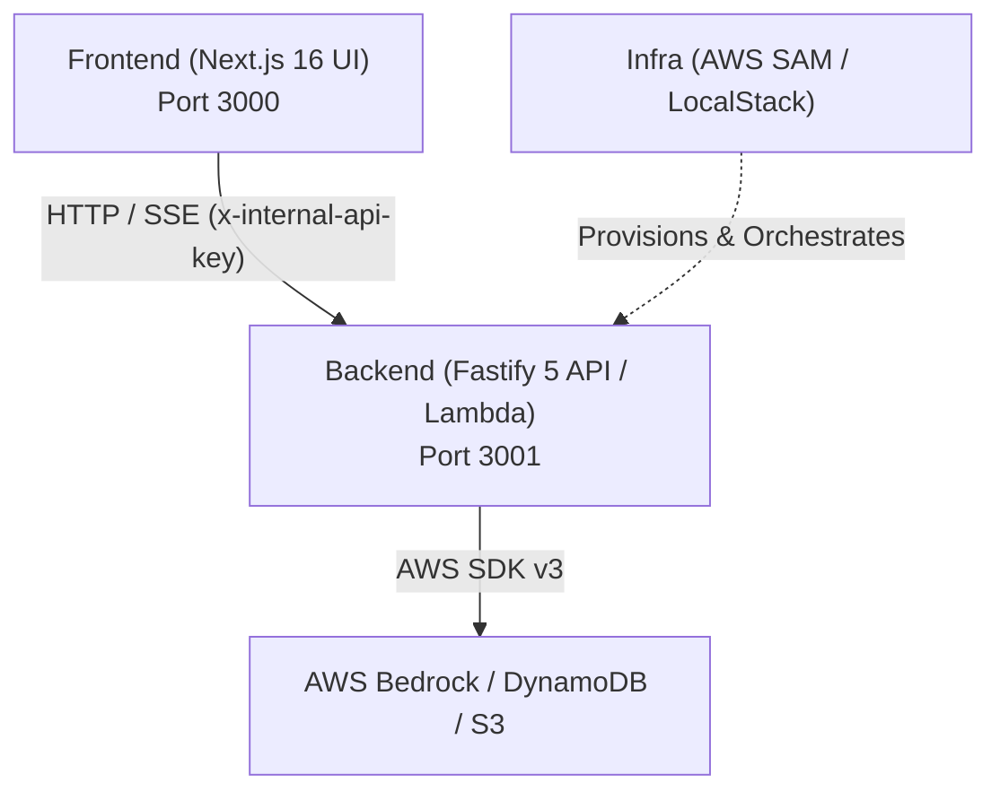

# AGENTS.md — Repository Architecture & Agent Guidelines

Welcome to `genai-lab`! This document is the single source of truth for AI coding agents and human developers pair-programming in this repository. Follow these guidelines to maintain architectural integrity, consistent code conventions, and high test confidence.

---

## 1. System Architecture Overview

`genai-lab` is a modern AI-native monorepo structured into three distinct layers:



### 1.1 `backend/` — Fastify 5 REST API & Lambda Handler

- **Framework**: Fastify 5 with TypeScript (`fastify-cli`, `@fastify/autoload`).
- **Deployment Targets**: Runs standalone locally (`port 3001`) and in AWS Lambda via `@fastify/aws-lambda` (`backend/src/lambda.ts`).
- **Core Capabilities**:
  - Bedrock converse and streaming chat orchestrator with tool-calling capabilities (`backend/src/lib/bedrock/`).
  - DynamoDB-backed daily chat usage cap and visitor rate limiting (`backend/src/services/usageCounterService.ts`).
  - Strict header-based internal authorization (`backend/src/utils/auth.ts`, `backend/src/authorizer.ts`) validating `x-internal-api-key`.
- **Testing**: Native Node.js test runner (`node --test`) with `c8` code coverage and `ts-node/register`.

### 1.2 `frontend/` — Next.js 16 UI

- **Framework**: Next.js 16 (App Router) with React 19.
- **Styling & UI**: Tailwind CSS v4, shadcn/radix-ui primitives, Lucide React icons, and Motion (`motion`) animations.
- **Agent Note**: Read [frontend/AGENTS.md](file:///frontend/AGENTS.md) for breaking changes and conventions in Next.js 16.
- **Communication**: Interacts with the backend via fetch calls and SSE streams, passing the required authorization headers.

### 1.3 `infra/` — AWS SAM Infrastructure

- **Tooling**: AWS Serverless Application Model (SAM) with `template.yaml` and `samconfig.toml`.
- **Local Emulation**: Docker Compose and LocalStack (`infra/localstack-init.sh`) simulating API Gateway, Lambda, DynamoDB, and S3.
- **Environments**: Parameterized environment configurations in `infra/environments/`.

---

## 2. Non-Negotiable Coding & Verification Conventions

1. **Strict TypeScript**:
   - Zero tolerance for unresolved type errors. Always run typechecking before proposing or committing changes.
   - Avoid `any`. Prefer explicit interfaces, generics, and discriminated unions (e.g., `StreamChunk`).
2. **Prettier Code Formatting**:
   - All code must conform to the root [.prettierrc](file:///.prettierrc).
   - Use `npm run format:check` to check compliance and `npm run format` to automatically apply fixes.
3. **Frontend Linting**:
   - Frontend must pass `npm run lint` (ESLint) with zero errors.
4. **Zero Committed Secrets**:
   - Never commit `.env`, `.env.local`, or secret tokens.
   - Use [.env.example](file:///backend/.env.example) to document newly required environment variables.
   - All internal endpoints fail closed when `INTERNAL_API_KEY` is not configured.
5. **Atomic Conventional Commits**:
   - Group changes into single-purpose, bisectable commits following the Conventional Commits specification:
     ```text
     <type>(<scope>): [<JIRA-KEY>] <imperative description>
     ```
   - Examples:
     - `feat(verify): [GL-46] add root verification scripts and agent guidelines`
     - `fix(format): [GL-46] resolve prettier formatting in bedrock stream collector`
6. **Isolated Git Worktrees**:
   - AI agents and automated tools must work in isolated git worktrees (`.worktrees/<branch-name>`) created off latest `origin/main` to avoid contaminating active development branches.

---

## 3. Standard Development Commands

### 3.1 Repository Root Commands (Monorepo Workspaces)

| Command                  | Action                                                     | Scope / Notes                                                     |
| :----------------------- | :--------------------------------------------------------- | :---------------------------------------------------------------- |
| `npm run verify`         | Runs format check, lint, typecheck, and graph verification | **Primary Quality Gate**: must exit `0`                           |
| `npm run typecheck`      | Strict TypeScript validation across packages               | Runs `tsc --noEmit` on backend and frontend                       |
| `npm run format:check`   | Checks Prettier formatting across workspaces               | Non-destructive check                                             |
| `npm run format`         | Automatically formats files across workspaces              | Runs Prettier with write                                          |
| `npm run lint`           | Runs linters across workspaces                             | Runs ESLint on frontend                                           |
| `npm run test`           | Runs test suites across workspaces                         | Runs backend test suite                                           |
| `npm run build`          | Compiles backend TypeScript and builds frontend            | Workspace-wide build                                              |
| `npm run graph:generate` | Builds Graphify AST knowledge graph                        | Generates index in `graphify-out/` and `.agents/knowledge-graph/` |
| `npm run graph:query`    | Queries symbol / route dependencies and callers            | Single-lookup dependency and caller trace                         |
| `npm run graph:verify`   | Verifies knowledge graph presence and integrity            | Non-breaking check; warns if tools are absent                     |

### 3.2 Backend Package Commands (`backend/`)

```bash
cd backend
npm run dev           # Start TypeScript compilation watcher + Fastify server (port 3001)
npm run build:ts      # Compile TypeScript files into dist/
npm test              # Run unit and integration tests with coverage report
npm run typecheck     # Typecheck src/ and test/ suites without emitting code
npm run format:check  # Check formatting of backend files
npm run format        # Format backend files with Prettier
```

### 3.3 Frontend Package Commands (`frontend/`)

```bash
cd frontend
npm run dev           # Start Next.js local development server (port 3000)
npm run build         # Build production Next.js bundle
npm run lint          # Run ESLint validation
npm run typecheck     # Typecheck frontend app and components
npm run format:check  # Check formatting of frontend files
npm run format        # Format frontend files with Prettier
```

### 3.4 Infrastructure Commands (`infra/`)

```bash
# Start LocalStack and dependencies via Docker Compose (from root)
docker-compose up -d

# Build SAM application
sam build --template infra/template.yaml

# Run local API Gateway emulation
sam local start-api -t infra/template.yaml -p 3001
```

---

## 4. AST Knowledge Graph Indexing (Graphify)

`genai-lab` integrates **Graphify** tree-sitter AST parsing to maintain an architectural knowledge graph of routes, services, schemas, and UI components. This eliminates brute-force file tree scanning, lowers agent token consumption, and provides instantaneous dependency tracing.

### 4.1 Knowledge Graph Artifacts

- `.agents/knowledge-graph/graph.json` & `graphify-out/graph.json`: Machine-readable dependency graph containing AST nodes, call edges, import links, and community clusters.
- `.agents/knowledge-graph/GRAPH_REPORT.md`: Human-readable summary of repository modules and clusters.
- `.agents/knowledge-graph/graph.html`: Interactive visual graph visualization.

### 4.2 Querying Code Dependencies

Before modifying routes, services, or shared utilities, agents should trace relationships in a single lookup:

```bash
# Query dependencies and callers for a specific file or symbol
npm run graph:query "backend/src/routes/portfolio/index.ts"

# Or using the Graphify CLI directly
graphify query "backend/src/routes/portfolio/index.ts"
graphify path "portfolio" "portfolioService"
graphify explain "portfolioService"
```

### 4.3 Knowledge Graph Freshness Guidelines & Update Triggers

To prevent architectural drift and stale knowledge graph queries, developers and agents must regenerate the knowledge graph under the following conditions:

| Trigger Condition              | Description                                                           | Action                   |
| :----------------------------- | :-------------------------------------------------------------------- | :----------------------- |
| **Structural Refactoring**     | Renaming, moving, or deleting files, folders, or modules              | `npm run graph:generate` |
| **Route & Endpoint Additions** | Adding new Fastify backend routes or frontend API endpoints           | `npm run graph:generate` |
| **Service & Model Updates**    | Modifying backend service logic or data contracts                     | `npm run graph:generate` |
| **Story Completion Boundary**  | Prior to opening a Pull Request after all story tasks are checked off | `npm run graph:generate` |

### 4.4 Non-Breaking Fallback Policy

Knowledge graph generation requires Python / tree-sitter / Graphify CLI. In CI/CD runners or contributor environments where Graphify prerequisites are not installed:

- `npm run verify` executes `npm run graph:verify`, which detects missing dependencies, logs a graceful warning, and exits `0` (never hard-fails the build).
- Local AST generation via `npm run graph:generate` uses `--code-only` and `--no-label`, requiring zero LLM API keys.
