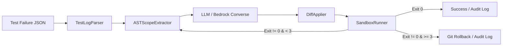

# Remediation Agent (`agent/`)

Autonomous Code Remediation & Sandbox Agent: Diagnoses CI/CD test failures using Tree-sitter AST queries, prompts generative LLMs for minimal unified diffs, and iteratively verifies patches in isolated Docker sandboxes.

Part of Jira Epic **[GL-52](https://the-three-devsketeers.atlassian.net/browse/GL-52)** and User Story **[GL-54](https://the-three-devsketeers.atlassian.net/browse/GL-54)**.

---

## Architecture Overview



---

## Quickstart & Installation

```bash
# 1. Create a Python virtual environment (Python 3.12+)
uv venv agent/.venv --python 3.12
# Or standard venv: python -m venv agent/.venv

# 2. Install package and dependencies in editable mode
uv pip install -e "agent/[dev]" --python agent/.venv/Scripts/python.exe
```

---

## CLI Usage

### 1. Diagnose Test Failures (Read-Only)

Parse test failure output and extract enclosing AST scopes without modifying files:

```bash
remediation-agent diagnose --input path/to/failure.json --repo .
```

### 2. Run Remediation Loop

Orchestrate the autonomous fix loop (up to 3 attempts):

```bash
# Offline / CI mock mode:
remediation-agent run --cmd "npm test" --mock-llm --output-log remediation-audit.json

# Live AWS Bedrock mode:
remediation-agent run --cmd "npm test" --model-id "anthropic.claude-3-5-sonnet-20241022-v2:0"
```

### 3. Format Pull Request Feedback Comment

Render a finished `RemediationSession` audit JSON into a validated `FeedbackReport` JSON envelope (including secret redaction, head/tail log budgeting, and one-click suggestion block eligibility):

```bash
remediation-agent format-comment \
  --session remediation-audit.json \
  --job-id job-pr56-001 \
  --pr-files pr-files.json \
  --output feedback-report.json
```

---

## Running Tests & Quality Verification

```bash
# Run pytest with code coverage
pytest agent/tests -v --cov=remediation_agent

# Run ruff linter
ruff check agent/
```
