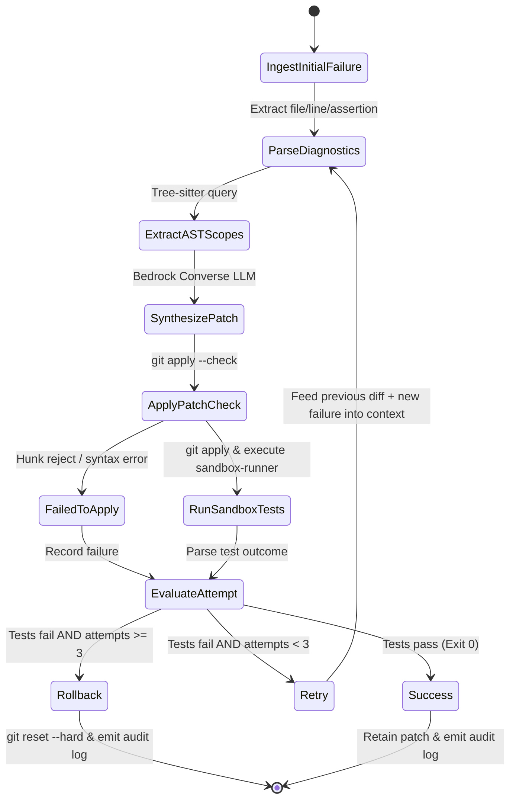

# Data Model: Tree-sitter AST Diagnostic and Patch Synthesis Loop

**Feature**: `001-ast-patch-synthesis`  
**Date**: 2026-11-06  
**Status**: Completed  

---

## Domain Entities & Schema Definitions (Pydantic v2)

### 1. TestFailureDiagnostic

Represents a single parsed test assertion failure extracted from test execution output.

```python
class TestFailureDiagnostic(BaseModel):
    file_path: str = Field(..., description="Repository-relative path to the failing source or test file")
    line_number: int = Field(..., ge=1, description="1-based line number where the failure or assertion occurred")
    error_type: str = Field(..., description="Class or identifier of error (e.g. AssertionError, TypeError)")
    message: str = Field(..., description="Extracted error assertion text or stack trace summary")
    test_name: Optional[str] = Field(None, description="Name of the failing test case or suite")
```

### 2. CodeContextScope

Represents the isolated structural AST scope surrounding a failure point, extracted via Tree-sitter.

```python
class EnclosingScope(BaseModel):
    scope_type: str = Field(..., description="AST node type: 'function_definition', 'class_definition', 'method_definition', etc.")
    name: str = Field(..., description="Name of enclosing function, class, or method")
    start_line: int = Field(..., ge=1, description="1-based start line of the enclosing AST node")
    end_line: int = Field(..., ge=1, description="1-based end line of the enclosing AST node")
    code: str = Field(..., description="Source code text of the enclosing scope")

class CodeContextScope(BaseModel):
    file_path: str = Field(..., description="Repository-relative path of the analyzed file")
    imports: List[str] = Field(default_factory=list, description="Top-level import declarations extracted from file")
    enclosing_scopes: List[EnclosingScope] = Field(default_factory=list, description="Hierarchical enclosing scopes around failure point")
    surrounding_code: str = Field(..., description="Bounded code window formatted for prompt inclusion")
```

### 3. CandidatePatch

Represents a synthesized code modification generated by the LLM.

```python
class CandidatePatch(BaseModel):
    patch_id: str = Field(..., description="Unique identifier for the patch candidate (e.g. patch-1)")
    diff_text: str = Field(..., description="Raw unified diff text (diff -u format)")
    target_files: List[str] = Field(..., min_length=1, description="Target repository files modified by this diff")
    is_applicable: bool = Field(False, description="True if patch passes dry-run check without reject hunks")
    apply_error: Optional[str] = Field(None, description="Error message if patch failed application check")
```

### 4. RemediationAttempt

Represents one discrete cycle in the diagnostic, synthesis, and verification loop.

```python
class AttemptStatus(str, Enum):
    PENDING = "PENDING"
    DIAGNOSED = "DIAGNOSED"
    SYNTHESIZED = "SYNTHESIZED"
    APPLIED = "APPLIED"
    VERIFIED_SUCCESS = "VERIFIED_SUCCESS"
    VERIFIED_FAILURE = "VERIFIED_FAILURE"
    FAILED_TO_APPLY = "FAILED_TO_APPLY"

class RemediationAttempt(BaseModel):
    attempt_number: int = Field(..., ge=1, le=3, description="1-based attempt sequence number (max 3)")
    diagnostics: List[TestFailureDiagnostic] = Field(default_factory=list, description="Failure diagnostics addressed in this attempt")
    patch: Optional[CandidatePatch] = Field(None, description="Patch synthesized during this attempt")
    test_result: Optional[SandboxRunResult] = Field(None, description="Test outcome following patch application")
    status: AttemptStatus = Field(default=AttemptStatus.PENDING, description="Outcome status of this attempt")
    duration_ms: int = Field(0, description="Duration of this iteration in milliseconds")
```

### 5. RemediationSession / AuditLog

Represents the top-level session encapsulating the entire diagnostic and repair lifecycle.

```python
class SessionFinalStatus(str, Enum):
    RESOLVED = "RESOLVED"
    EXHAUSTED = "EXHAUSTED"
    ERROR = "ERROR"

class RemediationSession(BaseModel):
    session_id: str = Field(..., description="Unique UUID for this remediation run")
    repository_path: str = Field(..., description="Root repository path under repair")
    test_command: str = Field(..., description="Test command being verified")
    initial_failure: SandboxRunResult = Field(..., description="Initial test failure envelope triggering remediation")
    attempts: List[RemediationAttempt] = Field(default_factory=list, max_length=3, description="Sequence of attempts")
    final_status: SessionFinalStatus = Field(..., description="Final outcome state")
    rolled_back: bool = Field(False, description="True if workspace was reverted back to initial commit")
    created_at: datetime = Field(default_factory=datetime.utcnow)
    completed_at: Optional[datetime] = None
```

---

## Remediation Loop State Transitions



