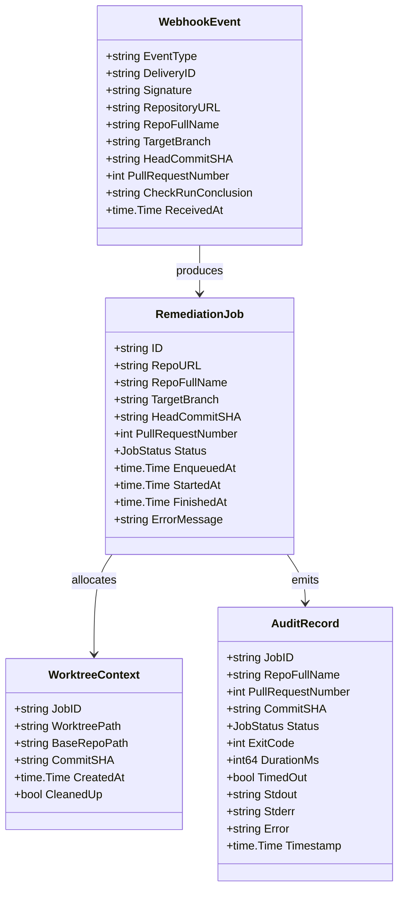
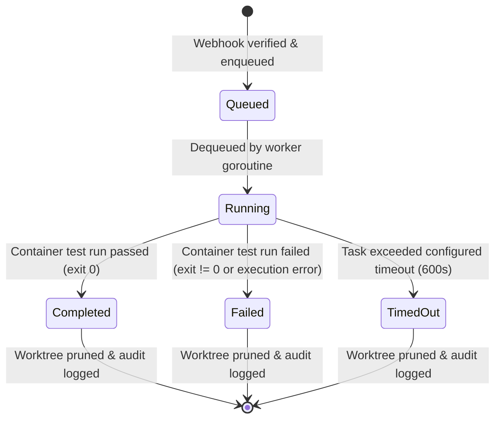

# Data Model: GitHub Webhook Consumer and Worktree Container Supervisor

**Feature**: GitHub Webhook Consumer and Worktree Container Supervisor  
**Date**: 2026-11-06  

---

## 1. Domain Entities & Type Definitions

---

## 2. Entity Details

### 2.1 `WebhookEvent`

Represents an incoming GitHub webhook delivery parsed after signature verification.

| Field | Type | Required | Description |
| :--- | :--- | :---: | :--- |
| `EventType` | `string` | Yes | GitHub event type header (`X-GitHub-Event`), e.g., `check_run` or `workflow_run` |
| `DeliveryID` | `string` | Yes | Unique delivery GUID from `X-GitHub-Delivery` header |
| `Signature` | `string` | Yes | Hex signature from `X-Hub-Signature-256` |
| `RepositoryURL` | `string` | Yes | Clone URL for the repository (`https://github.com/org/repo.git`) |
| `RepoFullName` | `string` | Yes | Target repository slug (`owner/repo`) |
| `TargetBranch` | `string` | Yes | Target branch name for the pull request (e.g. `feat/login`) |
| `HeadCommitSHA` | `string` | Yes | 40-character git commit SHA triggering the check run |
| `PullRequestNumber` | `int` | Yes | Associated Pull Request ID |
| `CheckRunConclusion`| `string` | Yes | Status conclusion (`failure`, `timed_out`, `success`, etc.) |
| `ReceivedAt` | `time.Time` | Yes | Host timestamp when HTTP request was received |

### 2.2 `RemediationJob`

An internal unit of work submitted to the bounded task queue and processed by a worker goroutine.

| Field | Type | Description |
| :--- | :--- | :--- |
| `ID` | `string` | Unique identifier (e.g., `job-pr42-c9a8f21`) |
| `RepoURL` | `string` | Git repository remote URL |
| `RepoFullName` | `string` | Repository slug |
| `TargetBranch` | `string` | Branch name |
| `HeadCommitSHA` | `string` | Target commit SHA |
| `PullRequestNumber`| `int` | PR number |
| `Status` | `JobStatus` | Enum: `Queued`, `Running`, `Completed`, `Failed`, `TimedOut` |
| `EnqueuedAt` | `time.Time` | Timestamp when pushed to buffered channel |
| `StartedAt` | `time.Time` | Timestamp when worker dequeued job |
| `FinishedAt` | `time.Time` | Timestamp when container run and cleanup completed |
| `ErrorMessage` | `string` | Failure error message if job encountered an unhandled error |

### 2.3 `JobStatus` State Transitions

### 2.4 `WorktreeContext`

Represents an ephemeral directory allocated for a single remediation job.

| Field | Type | Description |
| :--- | :--- | :--- |
| `JobID` | `string` | Associated `RemediationJob.ID` |
| `WorktreePath` | `string` | Absolute host filesystem path to temporary worktree |
| `BaseRepoPath` | `string` | Path to base repository maintaining git objects |
| `CommitSHA` | `string` | Commit checked out in the worktree |
| `CreatedAt` | `time.Time` | Directory creation timestamp |
| `CleanedUp` | `bool` | Flag set to `true` once pruned |

### 2.5 `AuditRecord`

Machine-readable JSON envelope persisted to `--audit-dir/<JobID>.json` upon job termination.

| Field | Type | Description |
| :--- | :--- | :--- |
| `JobID` | `string` | Unique job identifier |
| `RepoFullName` | `string` | Repository slug |
| `PullRequestNumber`| `int` | Associated PR number |
| `CommitSHA` | `string` | Commit SHA tested |
| `Status` | `string` | Final status (`Completed`, `Failed`, `TimedOut`) |
| `ExitCode` | `int` | Container exit code |
| `DurationMs` | `int64` | Container execution duration in milliseconds |
| `TimedOut` | `bool` | True if container was terminated due to timeout |
| `Stdout` | `string` | Captured stdout from container run |
| `Stderr` | `string` | Captured stderr from container run |
| `Error` | `string` | Error string if runtime execution failed |
| `Timestamp` | `time.Time` | Completion timestamp |

---

## 3. Validation Rules

1. **HMAC Signature Validation**:
   - `X-Hub-Signature-256` header MUST start with prefix `sha256=`.
   - Length of hex digest MUST equal 64 characters (32 bytes).
   - Comparison MUST execute using `subtle.ConstantTimeCompare`.
2. **Payload Size Guard**:
   - HTTP request body reader MUST be capped at 10 MB (`http.MaxBytesReader`) to avoid memory saturation attacks.
3. **Commit SHA Validation**:
   - `HeadCommitSHA` MUST match standard hexadecimal format (`^[0-9a-fA-F]{40}$`).
4. **Queue Capacity Guard**:
   - Worker queue channel has bounded buffer capacity of 50 items.
   - Non-blocking push drops to HTTP 429 when channel is full.
5. **Worktree Directory Validation**:
   - Ephemeral paths MUST reside within the configured `--worktree-base` root to prevent path traversal vulnerabilities.
