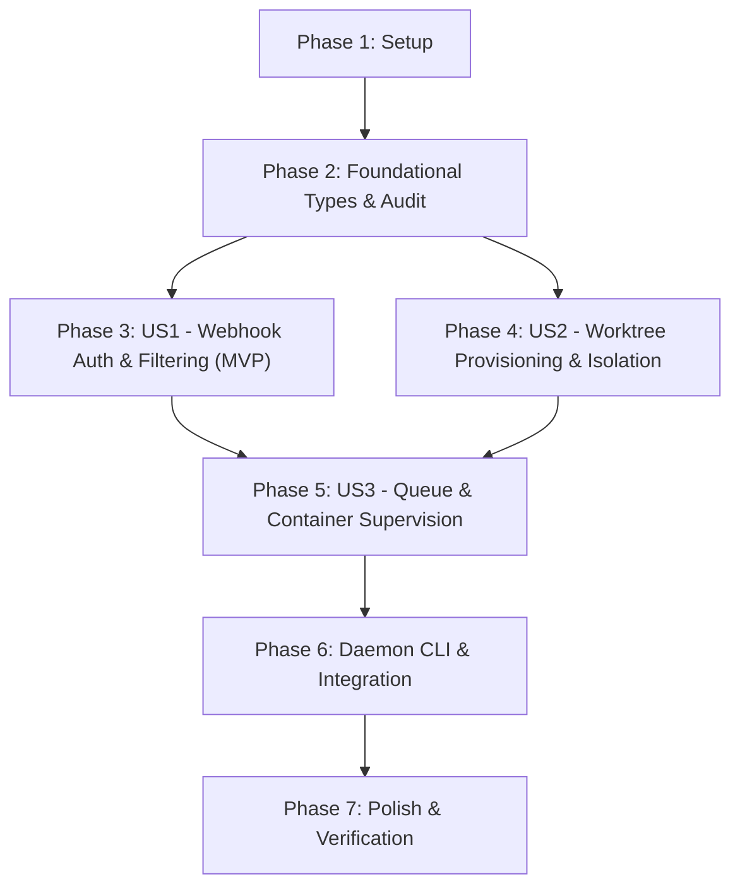

# Tasks: GitHub Webhook Consumer and Worktree Container Supervisor

**Input**: Design documents from `/specs/002-webhook-worktree-supervisor/`  
**Prerequisites**: `plan.md` (required), `spec.md` (required), `research.md`, `data-model.md`, `contracts/`, `quickstart.md`  
**Tests**: Follows Constitution Principle I (TDD at public seams: write failing tests first before implementation).  
**Organization**: Tasks are grouped by user story to enable independent implementation and testing of each story.

## Format: `[ID] [P?] [Story] Description`

- **[P]**: Can run in parallel (different files, no dependencies)
- **[Story]**: Which user story this task belongs to (`[US1]`, `[US2]`, `[US3]`)
- Exact file paths included in all descriptions

---

## Phase 1: Setup (Shared Infrastructure)

**Purpose**: Directory scaffolding, package setup, test fixtures, and shared development tooling in `sandbox-runner`.

- [ ] T001 Create package directory structure in `sandbox-runner/cmd/daemon`, `sandbox-runner/pkg/webhook`, `sandbox-runner/pkg/worktree`, `sandbox-runner/pkg/supervisor`, and `sandbox-runner/pkg/audit`
- [ ] T002 [P] Create mock webhook test fixtures in `sandbox-runner/testdata/webhooks/check_run_failure.json` matching `contracts/github-webhook-payload.json`
- [ ] T003 [P] Create mock webhook test fixtures in `sandbox-runner/testdata/webhooks/check_run_success.json` and `sandbox-runner/testdata/webhooks/workflow_run_failure.json`
- [ ] T004 [P] Create sample git repository fixture helper in `sandbox-runner/testdata/helpers.go` for worktree integration tests

---

## Phase 2: Foundational (Blocking Prerequisites)

**Purpose**: Core domain types, schemas, and persistence helpers that MUST be complete before ANY user story can be implemented.

**⚠️ CRITICAL**: No user story work can begin until this foundational phase is complete.

- [ ] T005 [P] Implement core webhook domain types and event structures in `sandbox-runner/pkg/webhook/types.go` (`WebhookEvent` with `EventType`, `DeliveryID`, `Signature`, `RepositoryURL`, `RepoFullName`, `TargetBranch`, `HeadCommitSHA`, `PullRequestNumber`, `CheckRunConclusion`)
- [ ] T006 [P] Implement supervisor job models and state transitions in `sandbox-runner/pkg/supervisor/types.go` (`RemediationJob` with status enum `Queued`, `Running`, `Completed`, `Failed`, `TimedOut`, and `WorktreeContext`)
- [ ] T007 [P] Implement JSON audit envelope writer in `sandbox-runner/pkg/audit/audit.go` adhering to `contracts/job-audit-schema.json` (`AuditRecord` persisting to `--audit-dir/<job_id>.json`)
- [ ] T008 Write unit tests for domain model serialization and audit file writing in `sandbox-runner/pkg/audit/audit_test.go`

**Checkpoint**: Foundation ready - user story implementation can now begin.

---

## Phase 3: User Story 1 - Secure Webhook Authentication & CI Event Filtering (Priority: P1) 🎯 MVP

**Goal**: Authenticate incoming GitHub webhooks using constant-time HMAC SHA-256 signature verification, parse and filter for qualified failing CI events (`check_run` and `workflow_run` on pull requests), and return non-blocking HTTP responses (202 Accepted, 200 OK ignored, 401 Unauthorized, 400 Bad Request).

**Independent Test**: Send webhook requests with valid signatures, invalid signatures, missing signatures, and non-target events to the HTTP handler; verify 401 for bad/missing signatures, 200 for non-failing runs, and 202 with job metadata for valid failing PR events.

### Tests for User Story 1 (TDD - Write First)

- [ ] T009 [P] [US1] Write unit tests for constant-time HMAC SHA-256 verification in `sandbox-runner/pkg/webhook/validator_test.go` testing valid signatures, tampered payloads, missing headers, empty secret, and malformed hex strings
- [ ] T010 [P] [US1] Write unit tests for GitHub webhook payload parsing in `sandbox-runner/pkg/webhook/parser_test.go` verifying extraction of commit SHA, branch name, PR number, and repository URLs from `check_run` and `workflow_run` payloads
- [ ] T011 [P] [US1] Write HTTP handler tests in `sandbox-runner/pkg/webhook/handler_test.go` verifying 401 on bad signature, 400 on body exceeding 10MB limit, 200 on non-failing/non-PR events, and 202 on valid failing PR events

### Implementation for User Story 1

- [ ] T012 [US1] Implement `VerifySignature` in `sandbox-runner/pkg/webhook/validator.go` using `crypto/hmac`, `crypto/sha256`, and `crypto/subtle.ConstantTimeCompare`
- [ ] T013 [US1] Implement `ParseEvent` in `sandbox-runner/pkg/webhook/parser.go` deserializing qualifying `check_run` (conclusion `failure`/`timed_out`) and `workflow_run` (conclusion `failure`) events per `contracts/github-webhook-payload.json`
- [ ] T014 [US1] Implement `WebhookHandler` in `sandbox-runner/pkg/webhook/handler.go` wrapping `http.MaxBytesReader` (10MB ceiling), invoking validator, filtering events, and returning immediate JSON responses per `contracts/http-api-contract.md`
- [ ] T015 [US1] Implement `/healthz` probe endpoint in `sandbox-runner/pkg/webhook/handler.go` reporting server health, uptime, and queue status

**Checkpoint**: User Story 1 is fully functional and independently testable (MVP delivery).

---

## Phase 4: User Story 2 - Ephemeral Worktree Provisioning & Lifecycle Management (Priority: P2)

**Goal**: Provision ephemeral git worktrees in isolated temporary directories linked to the target commit SHA, prevent branch collision across concurrent jobs, and guarantee immediate pruning/cleanup on task completion, failure, or timeout.

**Independent Test**: Trigger a worktree allocation for a given commit SHA; verify a clean directory is created off the target commit without modifying the base repository, and confirm that calling `Prune` cleanly removes the worktree and cleans up git metadata.

### Tests for User Story 2 (TDD - Write First)

- [ ] T016 [P] [US2] Write unit tests for `GitExecutor` command builder in `sandbox-runner/pkg/worktree/executor_test.go` validating arguments for `git worktree add`, `git worktree remove --force`, and `git worktree prune`
- [ ] T017 [P] [US2] Write unit tests for `WorktreeManager` in `sandbox-runner/pkg/worktree/manager_test.go` validating isolated directory generation under `--worktree-base`, branch isolation, and error handling for invalid commit SHAs
- [ ] T018 [P] [US2] Write cleanup and pruning tests in `sandbox-runner/pkg/worktree/manager_test.go` verifying worktree removal on task completion, failure, and locked file retries

### Implementation for User Story 2

- [ ] T019 [US2] Define `GitExecutor` interface and `OSGitExecutor` in `sandbox-runner/pkg/worktree/executor.go` executing git commands via `os/exec` with context cancellation
- [ ] T020 [US2] Implement `WorktreeManager` in `sandbox-runner/pkg/worktree/manager.go` implementing `Create(ctx context.Context, repoPath, commitSHA, jobID string) (*WorktreeContext, error)`
- [ ] T021 [US2] Implement `Prune(ctx context.Context, wt *WorktreeContext) error` in `sandbox-runner/pkg/worktree/manager.go` executing `git worktree remove --force` followed by filesystem directory cleanup
- [ ] T022 [US2] Add directory sweep and error logging fallback in `sandbox-runner/pkg/worktree/manager.go` to ensure zero orphaned directories remain even if git commands fail

**Checkpoint**: User Story 2 provides isolated, leak-free worktree lifecycles for concurrent jobs.

---

## Phase 5: User Story 3 - Concurrent Task Queue & Container Execution Supervision (Priority: P3)

**Goal**: Ingest remediation tasks into a bounded channel work queue (default: 50 items) returning HTTP 429 backpressure when saturated, supervise a fixed worker pool (default: 3 workers) running containers via `pkg/sandbox.Runner`, enforce per-task execution timeouts (default: 600s), and persist structured audit logs.

**Independent Test**: Dispatch concurrent webhook requests exceeding worker limit; verify workers execute up to concurrency limit, excess jobs queue in FIFO order, saturated queue returns HTTP 429 with `Retry-After: 60`, timed-out tasks are terminated within 5s, and all jobs write audit logs.

### Tests for User Story 3 (TDD - Write First)

- [ ] T023 [P] [US3] Write unit tests for bounded job queue in `sandbox-runner/pkg/supervisor/queue_test.go` verifying non-blocking enqueue, channel buffer saturation detection, and FIFO dequeueing
- [ ] T024 [P] [US3] Write unit tests for worker supervisor in `sandbox-runner/pkg/supervisor/supervisor_test.go` using `MockDockerAPI` and `MockGitExecutor` verifying concurrency limit enforcement (3 workers) and container execution orchestration
- [ ] T025 [P] [US3] Write task timeout enforcement tests in `sandbox-runner/pkg/supervisor/supervisor_test.go` verifying container termination, status marked as `TimedOut`, worktree pruned, and audit log recorded when execution exceeds timeout limit
- [ ] T026 [P] [US3] Write graceful shutdown tests in `sandbox-runner/pkg/supervisor/shutdown_test.go` verifying in-flight worker tasks complete and active worktrees are cleaned up upon context cancellation

### Implementation for User Story 3

- [ ] T027 [US3] Implement `BoundedQueue` in `sandbox-runner/pkg/supervisor/queue.go` using `chan *RemediationJob` (capacity 50) with non-blocking enqueue returning error on saturation
- [ ] T028 [US3] Wire HTTP 429 Too Many Requests response with `Retry-After: 60` header into `sandbox-runner/pkg/webhook/handler.go` when `BoundedQueue.Push` detects saturation
- [ ] T029 [US3] Implement `WorkerSupervisor` in `sandbox-runner/pkg/supervisor/supervisor.go` orchestrating the worker pool: dequeueing jobs, creating worktrees via `WorktreeManager`, executing containers via `sandbox.Runner.Run()`, persisting audit records via `pkg/audit`, and deferring worktree pruning
- [ ] T030 [US3] Implement per-task timeout enforcement and cancellation context in `sandbox-runner/pkg/supervisor/supervisor.go` terminating hanging containers after configured duration (default: 600s)
- [ ] T031 [US3] Implement graceful worker draining and channel closure via `sync.WaitGroup` in `sandbox-runner/pkg/supervisor/supervisor.go`

**Checkpoint**: All three user stories are functional and fully integrated into the worker supervisor pipeline.

---

## Phase 6: Daemon CLI & System Integration

**Purpose**: Assemble all components into the `daemon` binary CLI, bind HTTP routing, parse environment variables and flags, and handle OS termination signals.

- [ ] T032 Write CLI flag and environment variable parsing tests in `sandbox-runner/cmd/daemon/main_test.go`
- [ ] T033 Implement daemon entry point in `sandbox-runner/cmd/daemon/main.go` wiring `--port`, `--secret`, `--repo`, `--worktree-base`, `--audit-dir`, `--concurrency`, `--queue-size`, and `--timeout` flags per `contracts/http-api-contract.md`
- [ ] T034 Implement OS signal listener (SIGINT, SIGTERM) in `sandbox-runner/cmd/daemon/main.go` triggering `Supervisor.Shutdown(ctx)` with a 30-second graceful drain window

---

## Phase 7: Polish & Cross-Cutting Concerns

**Purpose**: Documentation, end-to-end verification, and repository quality gates.

- [ ] T035 [P] Update `sandbox-runner/README.md` documenting daemon architecture, CLI flags, webhook integration guide, and sample curl commands
- [ ] T036 Run end-to-end quickstart verification scenarios per `specs/002-webhook-worktree-supervisor/quickstart.md`
- [ ] T037 Execute full test suite with race detector (`go test -v -race ./...` in `sandbox-runner`) and verify clean formatting across repository (`npm run verify`)

---

## Dependencies & Execution Order

### Phase Dependencies



### User Story Dependencies

- **User Story 1 (P1)**: Depends on Foundational Phase (Phase 2). Can be delivered independently as MVP.
- **User Story 2 (P2)**: Depends on Foundational Phase (Phase 2). Operates independently to provision and prune worktrees.
- **User Story 3 (P3)**: Depends on US1 (for parsed webhook jobs) and US2 (for ephemeral worktrees) to orchestrate container runs.

---

## Parallel Opportunities

```bash
# Phase 1 Setup (parallel)
T002: Create mock failure fixture in sandbox-runner/testdata/webhooks/check_run_failure.json
T003: Create mock success fixture in sandbox-runner/testdata/webhooks/check_run_success.json
T004: Create sample git repo helper in sandbox-runner/testdata/helpers.go

# Phase 2 Foundational (parallel)
T005: Core webhook domain types in sandbox-runner/pkg/webhook/types.go
T006: Supervisor job models in sandbox-runner/pkg/supervisor/types.go
T007: JSON audit writer in sandbox-runner/pkg/audit/audit.go

# Phase 3 US1 Tests (parallel)
T009: HMAC validator unit tests in sandbox-runner/pkg/webhook/validator_test.go
T010: Webhook parser unit tests in sandbox-runner/pkg/webhook/parser_test.go
T011: HTTP handler unit tests in sandbox-runner/pkg/webhook/handler_test.go

# Phase 4 US2 Tests (parallel)
T016: GitExecutor tests in sandbox-runner/pkg/worktree/executor_test.go
T017: WorktreeManager tests in sandbox-runner/pkg/worktree/manager_test.go

# Phase 5 US3 Tests (parallel)
T023: Bounded queue tests in sandbox-runner/pkg/supervisor/queue_test.go
T024: Worker supervisor tests in sandbox-runner/pkg/supervisor/supervisor_test.go
T025: Timeout enforcement tests in sandbox-runner/pkg/supervisor/supervisor_test.go
```

---

## Implementation Strategy

### MVP First (User Story 1 Only)
1. Complete Phase 1 (Setup) and Phase 2 (Foundational).
2. Complete Phase 3 (User Story 1: Webhook Auth & Filtering).
3. **Validate MVP**: Deliver verified webhook receiving endpoint that rejects invalid HMAC signatures and filters failing PR events.

### Incremental Delivery
1. Foundation + US1 → Secure webhook ingestion and filtering (MVP).
2. Add US2 → Ephemeral worktree isolation and reliable pruning.
3. Add US3 → Bounded task queuing, container execution supervision, and audit logging.
4. Add Phase 6 → Standalone `daemon` CLI binary with graceful shutdown.
5. Add Phase 7 → End-to-end verification and documentation.
