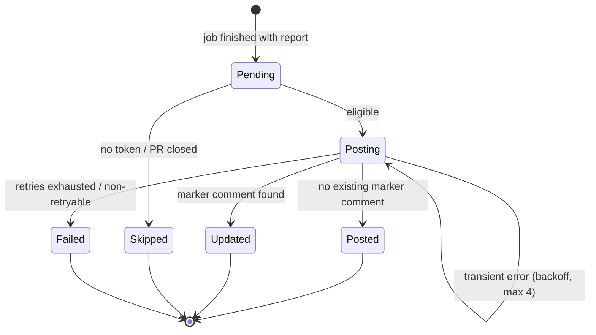

# Data Model: Automated GitHub PR Feedback Comments

## FeedbackReport (discriminated on `verdict`)

Produced by the agent from a `RemediationSession`; validated by [feedback-report.schema.json](contracts/feedback-report.schema.json).

| Field | Type | Applies to | Notes |
| :--- | :--- | :--- | :--- |
| `schema_version` | string | both | `"1.0"` |
| `verdict` | `"verified_fix"` \| `"failed"` | both | Maps from `SessionFinalStatus` `RESOLVED` / `EXHAUSTED` or `ERROR` |
| `job_id` | string | both | Supervisor job ID; used for idempotency marker |
| `session_id` | string | both | Agent session UUID |
| `diagnosis` | string (1..4000) | both | Root cause; never truncated |
| `duration_ms` | int ≥ 0 | both | Total remediation duration |
| `attempts` | `AttemptSummary[]` (1..3) | both | Full history |
| `diff` | `VerifiedDiff` | `verified_fix` only | Absent on failure by construction |
| `test_log` | string | `verified_fix` | Redacted sandbox pass log |
| `markdown_body` | string | both | Rendered summary, ≤ 60,000 chars, redacted |
| `suggestion` | `SuggestionSpec` \| null | `verified_fix` | Present only when diff is eligible |

### AttemptSummary

| Field | Type | Notes |
| :--- | :--- | :--- |
| `attempt_number` | int 1..3 | |
| `outcome` | enum | `verified_success`, `verified_failure`, `failed_to_apply` |
| `failure_reason` | string \| null | Required unless `verified_success`; redacted |
| `duration_ms` | int ≥ 0 | |

### VerifiedDiff

| Field | Type | Notes |
| :--- | :--- | :--- |
| `unified_diff` | string | Raw `diff -u` text |
| `target_files` | string[] | ≥ 1 |
| `commit_url` | string \| null | Set if supervisor pushed a branch |

### SuggestionSpec

| Field | Type | Notes |
| :--- | :--- | :--- |
| `path` | string | Repo-relative file |
| `start_line` / `line` | int | Inclusive range on the RIGHT side |
| `replacement` | string | Replacement text for the range |

Eligible only when: exactly one target file, one contiguous hunk, and the range lies within lines changed by the PR (supervisor verifies against the PR files API; if it cannot, it drops `suggestion` and relies on the collapsible diff).

## CommentPostingOutcome (added to audit `Record`)

| Field | Type | Notes |
| :--- | :--- | :--- |
| `feedback.status` | enum | `posted`, `updated`, `skipped`, `failed` |
| `feedback.reason` | string | e.g. `pr_closed`, `no_credentials`, `rate_limited`, `http_403` |
| `feedback.summary_comment_id` | int \| null | |
| `feedback.suggestion_comment_id` | int \| null | |
| `feedback.attempts` | int | Posting attempts used |

## State transitions

## Validation rules

- `verdict=failed` MUST NOT include `diff`, `suggestion`, or any fenced `diff`/`suggestion` block in `markdown_body` (checked by builder and re-checked in Go).
- `verdict=verified_fix` requires a diff with `target_files` ≥ 1 and the final attempt `verified_success`.
- `markdown_body` length ≤ 60,000 and must contain the marker comment exactly once.

