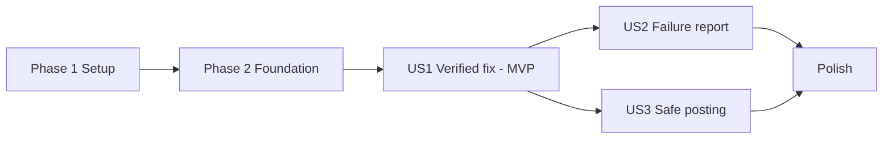

# Tasks: Automated GitHub PR Feedback Comments

**Input**: Design documents from `/specs/003-pr-feedback-comments/`  
**Prerequisites**: `plan.md` (required), `spec.md` (required), `research.md`, `data-model.md`, `contracts/`, `quickstart.md`  
**Tests**: Follows Constitution Principle I (TDD at public seams: write failing tests first, then implement). Only the GitHub HTTP boundary is mocked (`httptest`).  
**Organization**: Tasks are grouped by user story to enable independent implementation and testing of each story.

## Format: `[ID] [P?] [Story] Description`

- **[P]**: Can run in parallel (different files, no dependencies)
- **[Story]**: Which user story this task belongs to (`[US1]`, `[US2]`, `[US3]`)
- Exact file paths included in all descriptions

---

## Phase 1: Setup (Shared Infrastructure)

**Purpose**: Package scaffolding and fixtures in `agent/` and `sandbox-runner/`.

- [x] T001 Create package scaffolding `agent/src/remediation_agent/reporting/__init__.py` and `sandbox-runner/pkg/github/` (empty `doc.go` with package comment)
- [x] T002 [P] Create agent fixtures in `agent/tests/fixtures/feedback/`: `resolved_session.json` (single-file fix, attempt 2 of 3 succeeds), `resolved_multifile_session.json`, `exhausted_session.json` (3 failed attempts), `secrets_session.json` (logs containing `ghp_` token, `AKIA` key, `API_TOKEN=...`)
- [x] T003 [P] Create Go fixtures in `sandbox-runner/testdata/feedback/`: `verified_fix_report.json`, `failed_report.json`, `suggestion_report.json` conforming to `specs/003-pr-feedback-comments/contracts/feedback-report.schema.json`
- [x] T004 [P] Add `sandbox-runner/testdata/githubmock/server.go`: reusable `httptest.Server` recording requests and simulating `pulls/{n}`, `issues/{n}/comments` (paginated), `pulls/{n}/comments`, with injectable failures (502, 429 + `Retry-After`, 403, 404) Also simulate `GET pulls/{n}/files` returning per-file `patch` hunks (and a case with no `patch`).

---

## Phase 2: Foundational (Blocking Prerequisites)

**Purpose**: Report contract types shared by all stories (FR-014). MUST complete before user stories.

- [x] T005 [P] Write failing tests in `agent/tests/unit/test_reporting_models.py`: `verdict=failed` rejects `diff`/`suggestion`/`test_log`; `verified_fix` requires `diff.target_files` ≥ 1 and `test_log`; `diagnosis` 1..4000 chars; `attempts` 1..3; `attempt_number` 1..3; `markdown_body` ≤ 60000; serialized output validates against the JSON Schema
- [x] T006 Implement `FeedbackReport` (discriminated union on `verdict`), `AttemptSummary`, `VerifiedDiff`, `SuggestionSpec` with pydantic v2 `ConfigDict(frozen=True, extra="forbid")` in `agent/src/remediation_agent/reporting/models.py` per `data-model.md` (`schema_version` const `"1.0"`, `outcome` enum `verified_success|verified_failure|failed_to_apply`)
- [x] T007 [P] Write failing tests in `sandbox-runner/pkg/github/report_test.go`: decode valid fixtures; reject unknown fields, missing `job_id`, `markdown_body` > 60000, `failed` verdict containing `diff` or a ```` ```diff ```` / ```` ```suggestion ```` fence in `markdown_body`, and marker missing or duplicated
- [x] T008 Implement typed `FeedbackReport` decode and validation (`DisallowUnknownFields`, 1 MiB input cap) in `sandbox-runner/pkg/github/report.go` The validator also rejects any `failed` report whose body contains a ```` ```diff ````, ```` ```suggestion ```` fence or a commit URL (FR-006).
- [x] T009 [P] Write failing tests in `sandbox-runner/pkg/audit/audit_test.go` for the new `Feedback` block (`status` enum `posted|updated|skipped|failed`, `reason`, `summary_comment_id`, `suggestion_comment_id`, `attempts`), omitted when empty
- [x] T010 Extend `Record` with optional `Feedback *FeedbackOutcome` in `sandbox-runner/pkg/audit/audit.go` and add `audit.Writer.Update(jobID, FeedbackOutcome)` that rewrites `<job_id>.json` (FR-012)
- [x] T010a [P] Write failing tests in `agent/tests/unit/test_reporting_redaction.py` using `secrets_session.json`: `gh[pousr]_…`, `github_pat_…`, `AKIA[0-9A-Z]{16}`, `Bearer …`, and `NAME=value` where NAME matches `SECRET|TOKEN|PASSWORD|KEY` become `[REDACTED]` in diagnosis, logs, diff, and failure reasons (FR-009)
- [x] T010b Implement `redact` in `agent/src/remediation_agent/reporting/redaction.py`; `build_feedback_report` MUST call it before rendering
- [x] T010c [P] Write failing tests in `sandbox-runner/pkg/github/redact_test.go` for second-pass redaction of `markdown_body` and suggestion `replacement` before sending
- [x] T010d Implement Go `redact` in `sandbox-runner/pkg/github/redact.go`; `Commenter.Post` MUST call it before any request

**Checkpoint**: Report contract and audit extension ready.

---

## Phase 3: User Story 1 - Verified Fix Posted to the Pull Request (Priority: P1) 🎯 MVP

**Goal**: A verified remediation produces one PR comment with diagnosis, diff (one-click suggestion when eligible, else collapsible diff/commit link), and test log with duration.

**Independent Test**: Feed `resolved_session.json` through `format-comment`, post the report to the mock GitHub server, and verify exactly one summary comment containing all three sections (SC-001, SC-003).

### Tests for User Story 1

- [x] T011 [P] [US1] Write failing golden tests in `agent/tests/unit/test_reporting_renderer.py` for `render_comment` on single-file, multi-file, and commit-URL cases against `agent/tests/fixtures/feedback/*.md`; assert marker appears first and once, diagnosis, ```` ```diff ```` block, test log, duration (e.g. `12.4s`), attempt `2 of 3`
- [x] T012 [P] [US1] Write failing tests in `agent/tests/unit/test_reporting_builder.py` for `build_feedback_report(session, job_id, commit_url, pr_changed_lines)` mapping `RESOLVED` to `verified_fix`, picking the `VERIFIED_SUCCESS` attempt's patch and test log, summing durations, and computing `suggestion` only for one file / one contiguous hunk within `pr_changed_lines`
- [x] T013 [P] [US1] Write failing tests in `agent/tests/unit/test_reporting_truncation.py`: logs over budget keep first 40% and last 60% with `… N lines truncated …` marker, body ≤ 60,000 chars, diagnosis/verdict/duration never truncated, diff collapses to commit link when still over budget (FR-008)
- [x] T014 [P] [US1] Write failing tests in `agent/tests/unit/test_cli.py` (`format_comment`): exit 0 and schema-valid output for `resolved_session.json`; exit 2 with stderr message and no output file for missing/invalid session
- [x] T015 [P] [US1] Write failing tests in `sandbox-runner/pkg/github/comment_test.go` for the first-post flow: `GET pulls/{n}` open, list comments (no marker), `POST issues/{n}/comments` with headers `Authorization`, `Accept`, `X-GitHub-Api-Version`, `User-Agent`; plus suggestion eligible case posting `POST pulls/{n}/comments` with `commit_id`, `path`, `start_line`, `line`, `side=RIGHT` and marker `<!-- remediation-agent:pr-suggestion -->`; plus a PR with `state=closed` yields `skipped/pr_closed` with no comment calls (FR-013)

### Implementation for User Story 1

- [x] T016 [P] [US1] Implement head/tail log budgeting in `agent/src/remediation_agent/reporting/truncation.py`
- [x] T017 [US1] Implement `render_comment` for `verified_fix` (marker, diagnosis, collapsible diff, optional commit link, verification section with duration and attempt count, collapsible test log) in `agent/src/remediation_agent/reporting/renderer.py` per `contracts/github-api-contract.md`
- [x] T018 [US1] Implement `build_feedback_report` (including suggestion eligibility) in `agent/src/remediation_agent/reporting/builder.py`
- [x] T019 [US1] Add `format-comment` subcommand (`--session`, `--job-id`, `--commit-url` optional, `--pr-files` path to the `<job_id>.pr-files.json` written by the supervisor, `--output`) in `agent/src/remediation_agent/cli.py`; export public API from `agent/src/remediation_agent/reporting/__init__.py`
- [x] T020 [US1] Implement `Client` (base URL from `GITHUB_API_URL`, token from `GITHUB_TOKEN`, required headers, 30 s timeout, token never logged) in `sandbox-runner/pkg/github/client.go`
- [x] T021 [US1] Implement `Commenter.Post(ctx, job, report)` create path (PR state check, create summary comment, optional suggestion review comment) in `sandbox-runner/pkg/github/comment.go` It MUST apply `redact` and MUST refuse to send a `failed` body that contains code fences.
- [x] T021a [US1] Implement `ChangedLines(ctx, pr)` in `sandbox-runner/pkg/github/files.go` (`GET pulls/{n}/files`, paginated, parse right-side changed ranges from each `patch`; missing `patch` or API error yields no ranges) with tests in `sandbox-runner/pkg/github/files_test.go`; write `<audit-dir>/<job_id>.pr-files.json` as `{ "path": [[start,end], ...] }`
- [x] T022 [US1] Wire into job completion in `sandbox-runner/pkg/supervisor/supervisor.go`: write `<job_id>.pr-files.json` via `ChangedLines`, run `remediation-agent format-comment --session <audit-dir>/<job_id>.session.json --job-id <job_id> --pr-files <audit-dir>/<job_id>.pr-files.json --output <audit-dir>/<job_id>.feedback.json`, load that file, call `Commenter.Post`, and record the outcome via `audit.Writer.Update`; a missing or invalid report yields `skipped/no_report`; posting errors never change the job status
- [x] T022a [US1] Add supervisor tests in `sandbox-runner/pkg/supervisor/feedback_handoff_test.go` using a stubbed formatter executable: report found and posted; formatter fails or report missing yields `skipped/no_report` and job status is unchanged
- [x] T023 [US1] Add end-to-end test `TestEndToEndFeedback/verified` in `sandbox-runner/pkg/supervisor/feedback_e2e_test.go`: completed job with `verified_fix` report yields one summary comment (plus suggestion comment when eligible) and audit `feedback.status=posted` The normal path (no retries) completes in 30 seconds or less from job completion (SC-004).

**Checkpoint**: US1 fully functional and testable independently (MVP).

---

## Phase 4: User Story 2 - Informative Failure Report Without Broken Code (Priority: P2)

**Goal**: Exhausted or errored runs produce an explanatory comment listing every attempt, with zero code proposals.

**Independent Test**: Feed `exhausted_session.json`, verify the comment lists all 3 attempts with reasons and contains no `diff`/`suggestion` fence and no commit link (SC-002).

### Tests for User Story 2

- [x] T024 [P] [US2] Write failing golden test in `agent/tests/unit/test_reporting_renderer.py` for `failed` layout (attempt table, "No change is proposed" line) asserting the body contains none of ```` ```diff ````, ```` ```suggestion ````, or a commit URL
- [x] T025 [P] [US2] Write failing tests in `agent/tests/unit/test_reporting_builder.py` mapping `EXHAUSTED` and `ERROR` to `failed`, deriving `failure_reason` per attempt from `FAILED_TO_APPLY` (`patch.apply_error`) and `VERIFIED_FAILURE` (diagnostic summary), and never copying `patch.diff_text` into the report
- [x] T026 [P] [US2] Write failing test in `sandbox-runner/pkg/supervisor/feedback_e2e_test.go` `TestEndToEndFeedback/failed`: exactly one failure comment, no suggestion comment, audit `feedback.status=posted`

### Implementation for User Story 2

- [x] T027 [US2] Extend `render_comment` with the `failed` layout in `agent/src/remediation_agent/reporting/renderer.py`
- [x] T028 [US2] Extend `build_feedback_report` for `failed` verdicts in `agent/src/remediation_agent/reporting/builder.py` (no `diff`, `suggestion`, `test_log` fields)

**Checkpoint**: US1 and US2 both work independently.

---

## Phase 5: User Story 3 - Safe, Repeatable Posting (Priority: P3)

**Goal**: Update-in-place instead of duplicates, retries with backoff, rate-limit handling, secret redaction, skip rules, and audit of every outcome.

**Independent Test**: Run the mock server with a 502 then success, then post the same job and a second job for the same PR; verify one comment total, updated in place (SC-005, SC-006).

### Tests for User Story 3

- [x] T032 [P] [US3] Write failing tests in `sandbox-runner/pkg/github/comment_test.go`: marker comment found (including on page 2) leads to `PATCH issues/comments/{id}` and no POST; same `job_id` reposted yields identical PATCH; a later `job_id` replaces the body in place (Q2: A); suggestion review comment updated via `PATCH pulls/comments/{id}`, and deleted via `DELETE pulls/comments/{id}` when the new report has no suggestion or is `failed` (no stale one-click change may remain)
- [x] T033 [P] [US3] Write failing tests in `sandbox-runner/pkg/github/client_test.go`: retry up to 4 attempts with 1 s, 2 s, 4 s backoff plus jitter on 502 and network errors (use injectable clock/sleeper); 429 or 403 with `Retry-After` ≤ 60 s waits then retries; `Retry-After` > 60 s, plain 401/403, and 404 are non-retryable
- [x] T034 [P] [US3] Write failing tests in `sandbox-runner/pkg/github/comment_test.go` for skips: empty `GITHUB_TOKEN` yields `skipped/no_credentials` with zero HTTP calls; non-retryable failure yields `failed/http_403`
- [x] T035 [P] [US3] Write failing test in `agent/tests/unit/test_reporting_builder.py`: a verified result with an empty diff is reported as "no change needed" and not as a fix (spec edge case)

### Implementation for User Story 3

- [x] T038 [US3] Implement retry/backoff and rate-limit handling in `sandbox-runner/pkg/github/client.go` (injectable `Sleeper`, max 4 attempts, 60 s wait cap)
- [x] T039 [US3] Implement marker-based upsert (paginated list, PATCH vs POST, review-comment PATCH and DELETE of stale suggestions) in `sandbox-runner/pkg/github/comment.go`
- [x] T040 [US3] Implement skip rules and outcome mapping (`posted`, `updated`, `skipped`, `failed` with `reason`, attempts used) in `sandbox-runner/pkg/github/comment.go` and persist via `audit.Writer.Update` in `sandbox-runner/pkg/supervisor/supervisor.go`
- [x] T041 [US3] Handle the empty-diff "no change needed" case in `agent/src/remediation_agent/reporting/builder.py` and `renderer.py`

**Checkpoint**: All user stories independently functional.

---

## Phase 6: Polish & Cross-Cutting Concerns

- [x] T042 [P] Document `GITHUB_TOKEN` (scopes `pull_requests: write`, `issues: write`) and `GITHUB_API_URL` in `sandbox-runner/README.md` and `agent/README.md`; add `format-comment` usage example
- [x] T043 [P] Add a contract test in `agent/tests/unit/test_reporting_contract.py` and `sandbox-runner/pkg/github/report_test.go` that validates the same fixtures against `specs/003-pr-feedback-comments/contracts/feedback-report.schema.json` so Python and Go cannot drift
- [x] T044 Run `go test -race ./...` and `go vet ./...` in `sandbox-runner/`; `pytest` and `ruff check .` in `agent/`
- [x] T045 Execute every scenario in `specs/003-pr-feedback-comments/quickstart.md` and fix discrepancies
- [x] T046 Run `npm run graph:generate` then `npm run verify` from the repo root; both must exit 0

---

## Dependencies & Execution Order

- **Phase 1** → **Phase 2** → user stories. Phase 2 blocks everything.
- **US1 (P1)** starts after Phase 2; it is the MVP.
- **US2 (P2)** and **US3 (P3)** start after Phase 2. They extend files created in US1 (`renderer.py`, `builder.py`, `comment.go`, `client.go`), so merge US1 first or coordinate on those files. US2 and US3 do not depend on each other.
- **Polish** after all desired stories.
- Within a story: tests (failing) → models/helpers → services → wiring → end-to-end.



## Parallel Opportunities

- **Setup**: T002, T003, T004 together.
- **Foundation**: T005 ∥ T007 ∥ T009 ∥ T010a ∥ T010c (tests), then T006, T008, T010, T010b, T010d.
- **US1**: tests T011–T015 together; then T016 ∥ T020 ∥ T021a; Python track (T017→T018→T019) and Go track (T021→T022) run in parallel.
- **US2**: T024, T025, T026 together.
- **US3**: tests T032–T035 together; then T038, T039, T040, T041.
- **Polish**: T042 ∥ T043.

### Parallel example: User Story 1

```text
Agent track:  T011, T012, T013, T014 (tests) → T016 → T017 → T018 → T019
Go track:     T015 (test) → T020 → T021 → T022
Join:         T023 end-to-end
```

## Implementation Strategy

1. **MVP**: Phases 1–3 (US1). Verified fixes show up on PRs with diagnosis, diff, and test log.
2. **Increment 2**: US2, so failures are never silent and never propose broken code.
3. **Increment 3**: US3 hardening (idempotent update, retries and rate limits, skip rules, empty-diff handling). Secret redaction already ships in Foundational, so posting can be enabled after US1.
4. **Commits**: One atomic conventional commit per task group, for example `feat(reporting): [GL-56] add feedback report models`, with `[GL-56]` in every message and work done in `.worktrees/feat-GL-56-pr-feedback-comments`.


